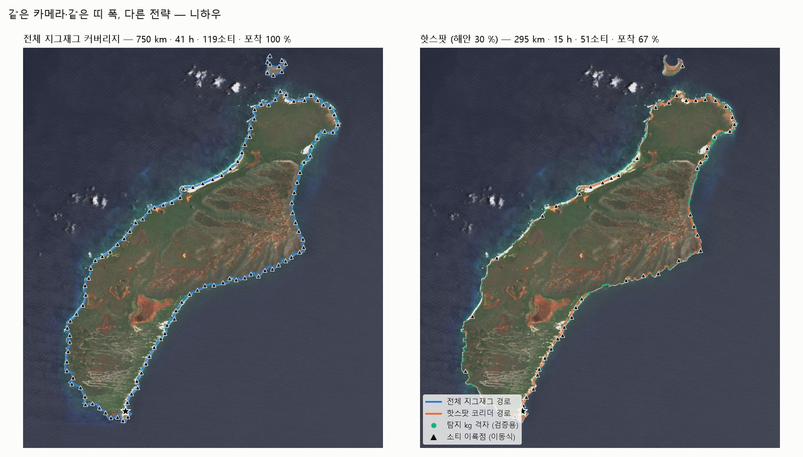
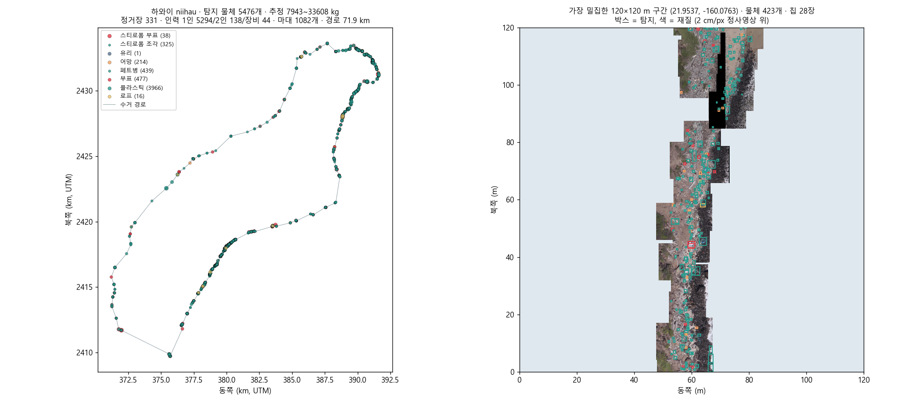

# 드론대장 붕붕이 — 해안쓰레기 드론 조사 · 무게 추정 · 수거계획 파이프라인

> 2026 항공·드론 산업 수요 기반 해커톤 (2026-09-30 ~ 10-02) · 팀 **드론대장 붕붕이**

지자체가 해안쓰레기를 치우려면 **어디에, 얼마나(무게), 몇 명과 몇 개의 마대가** 필요한지 미리 알아야 한다.
그런데 해안선 전체를 드론으로 매번 다 날 수는 없고, 위성 픽셀(10 m)로는 쓰레기가 보이지 않으며,
라벨 면적에 고정 계수를 곱해 매기는 무게는 높이를 모르기 때문에 실제보다 크게 작게 나올 수 있다.

이 저장소는 그 사이를 하나의 파이프라인으로 잇는다.

<p align="center">
  
  
</p>
<p align="center"><sub>왼쪽 — 해안 전체를 도는 대신 위성이 고른 30 % 만 날아 쓰레기의 67 % 포착 · 오른쪽 — 탐지 결과로 만든 수거 경로 (모두 하와이 니하우, 공개 데이터)</sub></p>

**배경**: [문제 제기와 기업 과제](docs/선행조사/01_문제제기_및_기업과제.md) · [선행조사](docs/선행조사/README.md)

```
 ① 어디를 날지 고르기          ② 어떻게 날지              ③ 무엇이 얼마나 있나            ④ 어떻게 치울지
 ─────────────────────        ─────────────────          ──────────────────────        ──────────────────
 해류·조석 → OpenDrift 좌초     핫스팟 우선 경로            드론 영상 → 탐지(YOLO)          구역 묶기 · 순회 순서
 위성 해안 형상 점수             (배터리 예산 오리엔티어링)   → 3D(COLMAP) → 위치(광선)      지형 최단경로(물·숲 회피)
 → 우선 구간 (상위 30 %)    →   + 지그재그 커버리지     →   → 부피(SAM2 투표)          →   마대 · 인원 · 시간 · 일정
 → 소티 분할 · DJI/Litchi 경로   + PX4 SITL 실비행 검증      → 무게(부피 × 겉보기 밀도)       → 현장용 인터랙티브 지도

 route_optimization/          path_planning/ hotspot/     litter/                       shoresweep_planner/
                              ros_sim/
```

**결론 한 문장**: 쓰레기가 쌓이는 자리는 지형과 조석이 정하므로 잘 바뀌지 않는다. 위성 해안 형상과 해류·바람 방향으로
그 자리를 골라(상위 30 % 구간에 쓰레기의 절반 이상) 드론을 반복 투입하고, 드론 영상의 3D 부피로 무게를 잡아
수거 계획을 세운다. 전체 해안은 가끔 전수·무작위로 확인한다.

> **데이터 공개 범위** — 해커톤에서 과제 기업이 제공한 현장 데이터(정사영상·라벨 등)는 외부 공개 금지 조건이었다.
> 이 저장소에는 그 데이터와, 데이터에서 나온 그림·수치·형식 정보를 넣지 않았다. 여기 실린 결과는 모두
> 공개 데이터(Sentinel-2, 하와이 항공조사, NOAA MDMAP, AI Hub, 튀니지, 공개 해류·조류예보)와 직접 촬영한 시험 영상에서 나온 것이다.

## 내 역할 (jihu0629)

팀원들이 단계를 나눠 맡았고, 나는 파이프라인의 **처음(① 어디를 날지)과 끝(④ 어떻게 치울지)**, 그리고 저장소 통합을 맡았다.

- **① 해류·위성 기반 경로 최적화** (`route_optimization/`)
  - Sentinel-2 영상에서 해안선을 뽑아 만입도·풍향 노출·해빈 폭으로 "쌓이기 쉬운 구간" 점수를 매기고, 배터리 25분 소티로 나눠 DJI/Litchi 비행 경로로 내보내는 모듈을 만들었다.
  - 공개 해류(Open-Meteo/Copernicus SMOC)와 국립해양조사원 조류예보로 OpenDrift 표류·좌초 시뮬을 돌려 경로 비용에 넣었다.
  - 니하우(하와이)·인천·강화에 적용해 "상위 30 % 구간에 쓰레기의 절반 이상", "인천 전체 지그재그 448 h → 57 h"를 확인했다.
- **④ 수거계획 알고리즘 · 현장 도구** (`shoresweep_planner/`)
  - 면적만 있는 라벨에서 겉보기 밀도 기반 무게 범위(최소/대표/최대)를 계산했다.
  - 정사영상 색으로 물·숲·맨땅 격자를 만들어 지형 최단경로를 구하고, 구역 묶기 → 순회 순서 → 마대·인원·일정으로 이어지는 계획기를 만들었다.
  - 결과 HTML 자체를 현장 계산기로 만들어 진행 체크, 내 위치, 길찾기, 팀 분할, 실시간 공유(Supabase) 기능을 넣었다.
- **통합** — 팀원 저장소와 내 저장소에 흩어진 브랜치들을 정리해 단계별 브랜치와 이 README로 합쳤다.

② 비행 경로·PX4 검증은 dohun, ③ 탐지·3D·무게는 codms-ai 의 작업이다.

---

## 브랜치 구성

`main` 은 모든 단계를 한 곳에 모은 **완성본**이다. 단계별 브랜치에는 각 단계의 코드와 결과물만 따로 담았다.

| 브랜치 | 단계 | 내용 | 주요 작업자 |
|---|---|---|---|
| **`main`** | 전체 | 4단계 통합 코드 + 이 문서 | 전원 |
| [`stage1-ocean-current-route`](../../tree/stage1-ocean-current-route) | ① | 해류 데이터 수집 · OpenDrift 좌초 시뮬 · 위성 우선순위 · 핫스팟 vs 전체 지그재그 비교 · 니하우 / 인천·강화 적용 | jihu0629 |
| [`stage2-flight-planning`](../../tree/stage2-flight-planning) | ② | 밀집 구간 근거(하와이·NOAA MDMAP) · 핫스팟 우선 경로 · 커버리지 경로 · PX4 SITL 실비행 | dohun |
| [`stage3-detection-3d-weight`](../../tree/stage3-detection-3d-weight) | ③ | YOLO 탐지 학습 · 3D 복원 · 위치 · SAM2 부피 · 무게 · 가상비행 시뮬 · 하와이/튀니지 교차평가 (공개 데이터 학습 가중치·결과물 포함) | codms-ai |
| [`stage4-collection-plan`](../../tree/stage4-collection-plan) | ④ | ShoreSweep Planner 수거계획 프로그램 | jihu0629 |

---

## ① 어디를 날지 — 해류·위성 기반 우선 구간과 경로 최적화 (`route_optimization/`)

위성으로는 쓰레기가 보이지 않는다. 대신 쓰레기가 **쌓이기 쉬운 해안의 모양**은 보인다.

1. **해안 형상 점수** (`litter3d/priority.py`): Sentinel-2(AWS 공개 버킷, `tools/fetch_s2_aws.py`)에서 물 마스크 → 해안선 → 10 m 표본점마다
   만입도(반경 150 m 물 비율), 풍향 노출(cos(법선 − 풍향)), 해빈 띠 폭(NDVI)을 재서 z 점수 가중합 → 200 m 구간.
2. **해류·조석** (`ocean_current_data/`, `incheon/`): Open-Meteo(Copernicus SMOC, 조석 포함)와
   국립해양조사원 조류예보로 90일 OpenDrift 표류·좌초를 돌려 구간별 좌초 밀도 → 경로 비용.
3. **예산 안 경로** : 상위 구간을 배터리 25분 소티로 나누고(최근접 이웃 + 2-opt, 이동식/고정 이륙),
   DJI WPML(`.kmz`)·Litchi(`.csv`)·GeoJSON 으로 내보낸다.
4. **전략 비교** (`litter3d/strategy.py`): 핫스팟 코리더 vs 전체 지그재그 커버리지의 시간 대비 포착량.

| 지역 | 결과 |
|---|---|
| 니하우 (하와이, 해안 98.8 km, 탐지 13.7 t) | 형상 점수 상위 **30 % 구간에 탐지 무게 65 %** (무작위 30 %). 이동식 이륙 12소티 · 132 km · 273분 |
| 인천·강화 (해안 1,108 km) | 조석 모델 집적 예상 해안 140 km(13 %)만 날면 전체 지그재그 448 h · 1,333소티 → **57 h · 178소티** |
| 경기만 OpenDrift | 집적 해안 88 km(8 %), 상위 15 % 비행 68 h(전체의 15 %) |

자세히: [`route_optimization/README.md`](route_optimization/README.md) · [`route_optimization/docs/ROUTE_OPTIMIZATION.md`](route_optimization/docs/ROUTE_OPTIMIZATION.md) (작업 내용·추론 과정·결론·피할 표현)

## ② 어떻게 날지 — 핫스팟 우선 경로 + 커버리지 + 실비행 검증 (`hotspot/`, `path_planning/`, `ros_sim/`)

- **밀집 구간은 존재하고 유지되는가** (`hotspot/`): 하와이 2015 항공조사(라벨 10,703개)에서 상위 10 % 격자에 라벨 **75 %**.
  NOAA MDMAP 반복조사 134곳의 앞/뒤 기간 밀도 순위상관 **0.88**, 앞 기간 상위 20 % 만 다시 가도 뒤 기간 쓰레기의 **56 %**.
- **경로** (`path_planning/`): `hotspot_route.py` 비행거리 예산 안 가치 최대 구간·순서(오리엔티어링, 가치/비용 삽입 + 2-opt, UCB 탐색 보너스),
  `coverage.py` 화각·고도·오버랩으로 줄 간격을 정한 지그재그.
- **PX4 SITL + Gazebo 실비행** (`ros_sim/`): 니하우 해안 항공사진(2 cm/px)을 깐 월드에서 하향 카메라 기체로 비행.
  전체 커버리지 3,524 m → 핫스팟 우선 **732 m (−79 %)**, 라벨 889개 모두 3장 이상 촬영, 1 km 당 확보 라벨 **4.8배**.

자세히: [`path_planning/README.md`](path_planning/README.md) · [`hotspot/README.md`](hotspot/README.md) · [`ros_sim/README.md`](ros_sim/README.md) · [`docs/핫스팟_우선경로_발표정리.md`](docs/핫스팟_우선경로_발표정리.md)

## ③ 무엇이 얼마나 — 드론 영상 → 탐지 · 3D · 위치 · 부피 · 무게 (`litter/`)

```
영상(.MP4)+SRT → 탐지(YOLO11) → 3D(COLMAP) → 위치(광선-지면) → 부피(SAM2 투표 + 높이지도) → 무게 → 작업카드
```

| 확인한 것 | 결과 |
|---|---|
| 3D 부피 (크기 아는 상자, 고도 2~7 m, 직접 촬영) | 부피 오차 **−10 ~ +20 %** |
| 위치 (합성 데이터, `python -m litter run --eval`) | 오차 중앙값: 드론 GPS 약 23 m → 화면 중앙 18~19 m → **픽셀 광선 2~2.3 m** |
| 무게 (합성 데이터) | 물체 오차 중앙값: 개수 × 14 g 97 % → 학습 2D+3D **28 %**, 23 kg 이상 물체 탐지 94 % |
| 탐지 (공개 데이터) | 하와이 8클래스 미세조정 재현율 0.24 → **0.69** · 튀니지 교차평가 |
| 가상비행 (`sim_ortho.py`) | 정사영상 위 커버리지 + 애매한 후보 저고도 재방문 시뮬레이터 |

자세히: [`docs/파이프라인_결과정리.md`](docs/파이프라인_결과정리.md) (결과 수치·그림) · [`docs/기술정리_전체.md`](docs/기술정리_전체.md) (단계별 기술·사용/미사용 모델) · [`litter/README.md`](litter/README.md)

## ④ 어떻게 치울지 — 수거계획 프로그램 ShoreSweep Planner (`shoresweep_planner/`)

```
쓰레기 위치·재질·면적(또는 ③의 3D 부피) + 정사영상
→ 무게(면적 × 채움률 × 두께 × 겉보기 밀도, 최소/대표/최대)
→ 정사영상 색으로 물·숲·맨땅 격자(10 m) → 지형 최단경로 (물 불가, 숲 ×3, 보트 모드)
→ 150 m 안 물체를 한 구역으로 → 구역 순회 (최단 이동 / 무게 우선) → 마대·시간·2인 운반 → 일차 분할
→ 수거계획.html (브라우저 안에서 재계산되는 현장 계산기) · 인쇄용 지도 · xlsx · csv
```

현장 기능: 진행 체크, 내 위치, 카카오맵/구글 길찾기, 팀 분할, 실측 보정, 시나리오 비교, 작업자 위치·완료 상태 실시간 공유(Supabase).
해커톤에서는 기업 제공 현장 데이터로 계획을 만들었고, 그 결과는 비공개라 싣지 않는다.

자세히: [`shoresweep_planner/README.md`](shoresweep_planner/README.md) (선행연구·방법 선택 근거·가정값과 한계)

---

## 폴더 구성

```
route_optimization/   ① 해류·위성 → 우선 구간 → 소티 경로          (stage1-ocean-current-route)
  ├─ litter3d/            priority.py(위성 해안 형상 점수·소티 분할·DJI/Litchi 내보내기) · strategy.py(전략 비교)
  ├─ ocean_current_data/  공개 해류·조류예보 수집 → OpenDrift 좌초 → 구간 밀도 → 경로 비용
  ├─ incheon/             인천·강화 조석 집적 지도 + 핫스팟 vs 전체 지그재그
  └─ scripts/ tests/ tools/ docs/
hotspot/              ② 밀집 구간 근거 실험 (하와이 항공조사, NOAA MDMAP)   (stage2-flight-planning)
path_planning/        ② 핫스팟 우선 경로 + 커버리지 경로
ros_sim/              ② PX4 SITL + Gazebo + ROS2 비행 검증
litter/               ③ 탐지·3D·위치·부피·무게 패키지 + 가상비행 시뮬      (stage3-detection-3d-weight)
shoresweep_planner/   ④ 수거계획 프로그램                                (stage4-collection-plan)
docs/                 선행조사, 결과·기술 정리, 발표 그림
```

## 실행

```bash
python -m venv .venv && source .venv/bin/activate     # Windows: .venv\Scripts\activate
pip install -r requirements.txt

# ① 위성 우선 구간 → 소티 경로 (니하우 예시, 재현 명령 전체는 route_optimization/README.md)
cd route_optimization && python -m pytest tests -q && cd ..

# ② 핫스팟 근거 (하와이 항공조사 데이터를 hotspot/data/ 에 받은 뒤) · PX4 비행 (Docker)
cd hotspot && python mdmap_persistence.py && python plot_results.py && cd ..
docker build -t aerodrone-px4-sim ros_sim
python ros_sim/hawaii/build_world.py && ros_sim/run_hawaii.sh hotspot

# ③ 탐지~무게~작업카드 (합성 데이터로 전 단계 확인)
python -m litter synth --out data/litter_synth
python -m litter run --images data/litter_synth/images --labels data/litter_synth/labels_coco.json \
  --weights data/litter_synth/weights.csv --telemetry data/litter_synth/telemetry.csv \
  --dsm data/litter_synth/dsm.tif --eval --out results/litter_synth_run

# ④ 수거계획 (input/ 에 라벨·정사영상과 config.json 을 넣고 실행 — input/README.md)
cd shoresweep_planner && python -m pytest tests -q && python run.py
```

GPU·학습 가중치·원본 영상이 필요한 단계(YOLO 학습, COLMAP 조밀복원, SAM2)는 [`litter/README.md`](litter/README.md)를 따른다.
공개 데이터로 학습한 가중치와 3D 결과물은 `stage3-detection-3d-weight` 브랜치의 `runs/` 에 있다.

## 문서

| 문서 | 내용 |
|---|---|
| [`docs/선행조사/`](docs/선행조사/README.md) | **문제 제기와 기업 과제**, 선행연구 종합, 핵심 논문 정리(Kako 2020 · Andriolo 2024), 드론 3D 측정 가능성, 초기 모델 검증 |
| [`docs/해안쓰레기_수거계획_방향정리.md`](docs/해안쓰레기_수거계획_방향정리.md) | 현장 문제(위치 어긋남, 무게 모름) 정의와 해결 방향 |
| [`route_optimization/docs/ROUTE_OPTIMIZATION.md`](route_optimization/docs/ROUTE_OPTIMIZATION.md) | ① 경로 최적화 작업·추론·결론 |
| [`docs/핫스팟_우선경로_발표정리.md`](docs/핫스팟_우선경로_발표정리.md) | ② 핫스팟 우선 경로 발표 정리 |
| [`docs/파이프라인_결과정리.md`](docs/파이프라인_결과정리.md) · [`docs/기술정리_전체.md`](docs/기술정리_전체.md) | ③ 결과 수치·그림 / 단계별 기술 |
| [`shoresweep_planner/README.md`](shoresweep_planner/README.md) | ④ 선행연구·방법론·가정값과 한계 |

## 저장소에 없는 것

기업 제공 현장 데이터와 그 분석 결과(비공개 약속), AI Hub 학습 데이터(수십 GB), 원본 드론 영상, Sentinel-2 원본 GeoTIFF, API 키.
공개 데이터는 각 README 의 명령으로 다시 받을 수 있다.
